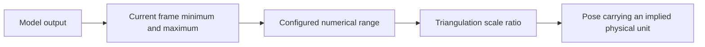

# মাত্রা · Matra

**A number does not become a distance because its field is labelled metres.**

Matra means a measure or dimension. This is a focused investigation from my perception-and-mapping experiments: where does the metre enter a monocular reconstruction, and can the depth preprocessing take it away again?

The preserved `flow_use` tree grew into a broad perception engine with depth, detections, features, tracking, flow, odometry and mapping. Two small methods carry a large part of its metric claim: a depth conversion and a triangulation-based scale estimator. Matra keeps their complete source modules, isolates those numerical methods unchanged, and tests their assumptions with known geometry.

It is separate from Dhrubotara's reference-image guidance work. This question is not whether image motion can supply a helpful arrow. It is whether a reconstruction has earned a physical unit.

## What actually runs

```bash
python -m venv .venv
.venv/bin/python -m pip install -e .
.venv/bin/python -m matra
.venv/bin/python -m unittest discover -s tests
```

CPU only. No camera, telemetry, GPU, neural weights, network model fetch or physical vehicle is involved. The command writes [`results/controlled.json`](results/controlled.json), including the software versions and the experiment definitions. This is synthetic geometric evidence and direct numerical execution—not a new run of the historical dashboard.

The experiment has three parts:

1. recover a known camera baseline using known metric depth;
2. change the depth scale without changing the image correspondences;
3. change one unrelated depth-map extreme while holding the inspected pixel fixed.

## First, the scale estimator does work under its assumptions

The geometry contains 88 exact correspondences, known 800-pixel focal lengths, a 640×480 image, identity relative rotation and a 0.4 m horizontal camera baseline. Scene points have known camera-axis depth. The second camera's translation direction is supplied with unit length, as in the contract of OpenCV's essential-matrix pose recovery.

The archived method triangulates the matches using that unit translation, samples the first depth map at their image locations, and computes:

$$
s = \frac{\operatorname{median}(Z_{input})}{\operatorname{median}(Z_{triangulated})}.
$$

It then scales the translation direction by this scalar. With the synthetic scene's true metric depth, the method recovers **0.400000075**, approximately the known 0.4 m baseline. The small numerical discrepancy comes from this controlled float32/float64 calculation; it is not a measured error on a real camera.

This is the positive result worth keeping. A metric reference can set the scale of an otherwise scale-ambiguous reconstruction. The problem is not the idea of using depth. It is the provenance and meaning of the depth supplied to it.

## Then change the ruler, not the image

Keep every correspondence, camera intrinsic, rotation and translation direction unchanged. Multiply only the input depth map:

| Input depth multiplier | Recovered translation scale | Interpretation relative to the original 0.4 m scene |
| ---: | ---: | --- |
| 0.5 | 0.200000 | Half-sized ruler, half-sized reconstruction |
| 1.0 | 0.400000 | Known metric ruler recovers the known baseline |
| 2.0 | 0.800000 | Doubled ruler, doubled reconstruction |

The scale estimator inherits the input's scale. It does not independently check that the input values are metres.

There is a geometric reason. Under a pinhole camera,

$$
u = f_x X/Z + c_x, \qquad v = f_y Y/Z + c_y.
$$

Multiply the entire world and the camera translation by the same positive scalar. The ratios in the projection stay the same. The command explicitly constructs a second world at twice the size, with a 0.8 m rather than 0.4 m baseline. The maximum difference between its projected second-camera points and the first world's projections is **0 pixels** in this calculation.

That is a gauge ambiguity in these image observations. It is not a claim that all monocular depth models are incapable of predicting metric values: learned metric models can bring priors, and other sensors or known geometry can supply a reference. It is a claim that this triangulation-and-ratio step cannot manufacture a metric reference from a scale-free input by itself.

If depth and scale history are both absent, the original method returns `1.0`. That is its numerical fallback, not evidence that the cameras were one metre apart.

## The conversion before the estimator

The archived `DepthEstimator` tries several model paths. Its default Transformers identifier is `depth-anything/Depth-Anything-V2-Small-hf`, whose model card tags the checkpoint as relative depth. There are also attempts to load other Depth Anything, ZoeDepth and MiDaS variants. Those paths do not all promise the same output convention or metric calibration.

Nevertheless, successful model paths pass through the same `_to_metric_depth` method:

```python
depth_norm = (depth_raw - depth_raw.min()) / (
    depth_raw.max() - depth_raw.min()
)
depth = min_depth + depth_norm * (max_depth - min_depth)
depth *= scale_factor
```

The original also handles a near-zero span by using zeros. Its preserved defaults are `min_depth=0.1`, `max_depth=20.0` and `scale_factor=1.0`.

This operation maps the current frame's numerical range into a configured range. It does not observe the scene's nearest and farthest physical distances. It also does not preserve an already metric model output unchanged. The label “convert to metric depth” is doing more work than the calculation.



The crucial missing edge is a calibrated relationship between the model output and the physical quantity represented by the sampled `Z` values.

## One different pixel changes the untouched one

The normalization experiment supplies a 10×10 array spanning 4 to 8. Its inspected pixel at row 5, column 5 has the raw value **6.222222**. A second array is identical except that the final pixel is changed to 80.

The inspected pixel has not changed. The method's output there changes from **11.155557 to 0.681871**.

This is a direct execution of the original conversion, not neural inference. It demonstrates dependence on an unrelated frame extreme. If these were intended as physical depths, a far object appearing elsewhere would be allowed to move an unchanged point's reported distance without a corresponding local measurement change.

For a heat map, frame-wise range normalization can be useful: it makes available contrast visible. For geometric reconstruction, silently using that same normalization as calibration changes the meaning of every point. Display normalization and metric measurement should remain separate operations.

## The exact assumptions matter

Even a genuine depth sensor is not automatically compatible with every `depth` field:

- **Camera-axis depth versus range:** triangulated `Z` is distance along the camera's optical axis. Slant range along a ray is a different quantity away from the image centre.
- **Camera model:** the known intrinsics used here are experiment inputs. They are not a calibration of the camera that recorded a historical preview. The preserved application's default intrinsics are also not calibration evidence.
- **Matching and cheirality:** this experiment supplies exact, correctly associated points and a valid translation direction. It does not test outlier rejection, repeated textures, pure-rotation degeneracy or learned feature matching.
- **Sampling:** the original method samples depth at integer pixel locations, filters numerical depth ranges, requires enough accepted points, clips its scale and smooths with a history median. Those are algorithmic choices, not substitutes for physical units.
- **Observation age:** a held scale history can provide continuity without being a fresh scale measurement. That distinction is not evaluated as a timing benchmark here.

The supported result is intentionally bounded: the archived scale estimator recovers a known baseline with a compatible metric input, scales with the ruler it is given, and receives scene-dependent values from the preserved frame-normalization path.

## What the source archive preserves

```text
matra/                  controlled geometry and unchanged numerical method bodies
origin/perception-system/
  depth/depth_estimator.py
  odometry/visual_odometry.py
  core/config.py
  core/types.py
results/controlled.json  actual numerical outputs and software versions
tests/                  metric recovery, scale ambiguity and normalization boundaries
provenance.json         original relative paths and SHA-256 source identities
```

The complete original modules remain unchanged. Only the two numerical method bodies are materialized into the supported baseline module; Torch imports, model downloads and the wider live application are not executed. Original source paths are recorded as `flow_use/...`, not rewritten into claims that the entire historical system is restored.

The archived code also contains a gradient-based fallback that labels its depth-like output valid. That source remains visible, but Matra neither uses it as a depth sensor nor presents it as a successful substitute for learned or measured depth. No neural network was evaluated by these experiments.

## What I would put at the interface

A usable system needs to distinguish **relative model output**, **metric camera-axis depth**, **ray range** and **a display-normalized image**. Their arrays can have the same shape while their meanings are incompatible.

A metric path should preserve actual metric depth and its frame convention. A relative path needs an explicitly justified scale/calibration source before it supplies metre-labelled reconstruction. A visualization should be free to stretch contrast without feeding its colours or display range back into geometry.

Those are requirements established by the counterexamples, not a claim that the archived application already implements a corrected end-to-end pipeline. This repository is the runnable research case study, with the old source and its limits intact.

## Attribution and further reading

The application/integration modules were supplied from Fahim Faisal's work archive. OpenCV's geometry algorithms, learned model implementations and their weights remain upstream work. This repository does not redistribute those model weights or claim their authorship; no blanket redistribution license has been applied to the historical snapshots.

- [OpenCV camera calibration and 3-D reconstruction API](https://docs.opencv.org/4.10.0/d9/d0c/group__calib3d.html): `recoverPose` returns a translation direction of unit length, known only up to scale; `triangulatePoints` reconstructs under the supplied projection matrices.
- [Depth Anything V2 Small Transformers model card](https://huggingface.co/depth-anything/Depth-Anything-V2-Small-hf): the exact default model identifier in the preserved source, including its relative-depth tag and upstream references.
- [Depth Anything V2 paper](https://arxiv.org/abs/2406.09414): linked by that model card; distinguish the broader model family from the specific checkpoint and conversion used in an application.

A map can be smooth, coloured and three-dimensional while its ruler is still undecided. Matra is about identifying the point at which that ruler enters the calculation.
